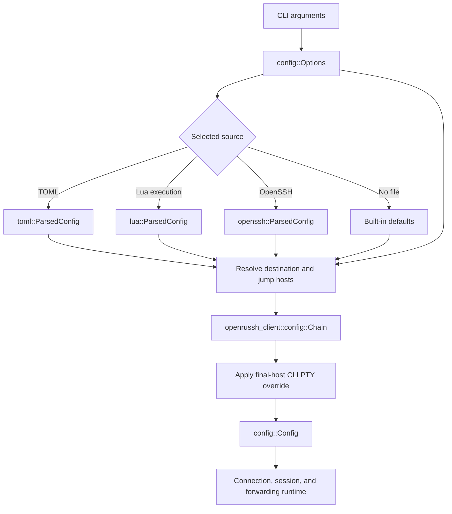

# Configuration architecture

Configuration has three distinct representations: inputs from the CLI,
format-specific results from reading a file, and resolved application settings.
They are concrete types with different responsibilities. The runtime consumes
only the resolved representation.

The [configuration reference](configuration.md) defines observable loading and
resolution rules. This document describes the types and processing boundaries
that implement them.

## Types and responsibilities

| Type | Meaning | Representation |
| --- | --- | --- |
| `config::Options` | CLI-derived inputs, overrides, and file-selection policy before loading. | Destination alias, optional user/port and overrides, selected file, session and forwarding options. |
| `config::toml::ParsedConfig<'src>` | The result of parsing a TOML document. | Native profiles that can borrow from the source text. |
| `config::lua::ParsedConfig` | The result of executing and deserializing a Lua chunk. | Owned native profiles, independent of the Lua VM and source text. |
| `config::openssh::ParsedConfig` | The result of parsing OpenSSH syntax with the CLI override prefix. | The dependency's `SshConfig`. |
| `config::formats::Profiles<'src>` | Shared Serde representation of native defaults and named host records. | A defaults record and a map of exact host aliases to `HostFields`. |
| `config::Config` | Format-independent, resolved application configuration for one invocation. | A connection `Chain`, session policy, stdin/escape policy, local forwards, and transport preferences. |

`Config` is a struct, not a configuration-provider trait or a union of file
formats. It has no Serde implementation, source-text lifetime, Lua value, file
handle, host-pattern table, or format tag. The runtime does not need to know
whether a file was OpenSSH, TOML, Lua, or absent.

The three `ParsedConfig` types are separate concrete types. Parsing or executing
one format does not manufacture another format's parser output. In particular,
TOML and Lua do not go through `ssh2_config::HostParams`: that type belongs to
the OpenSSH parser and its merging rules.

`Profiles` is deliberately a native source representation, not the universal
configuration model. It retains omitted fields, string/list alternatives,
unexpanded paths, defaults, and all named hosts. Sharing this representation
keeps TOML and Lua's host semantics consistent without imposing their schema on
OpenSSH. Its private `HostFields` records describe supplied fields rather than a
fully resolved SSH host.

## Loading pipeline



`cli::parse()` produces `Options`; it does not open configuration files or
establish a connection. `Options::load(self)` discovers one source, resolves its
connection chain, applies the final-host CLI PTY override, and moves the
remaining application settings into `Config`.

File selection is centralized in `Options`. Neither `Config` nor the runtime
contains extension checks or fallback logic. Explicit `-F`, default-file
precedence, and `-F none` use the same resolution endpoint. Failures from a
selected file retain the filename and underlying error; they do not trigger
fallback to another format.

Each format has an explicit construction step and a separate
`resolve(&Options) -> Result<Chain>` step:

- TOML: `ParsedConfig::parse(&str)` deserializes the text with `toml` and Serde.
- Lua: `ParsedConfig::execute(&str)` evaluates a Lua 5.4 chunk and deserializes its
  returned value with `mlua`'s Serde deserializer.
- OpenSSH: `ParsedConfig::parse(File, &Options)` seeds CLI overrides, then invokes
  the dependency's parser with `ALLOW_UNSUPPORTED_FIELDS`.

For OpenSSH, the override prefix is part of the parsed result. Parse and resolve
with the same override settings; changing those settings requires reparsing.
The prefix preserves the library's existing matching, `Include` scope, and
first-value/identity-list merging behavior. It is confined to the OpenSSH
adapter.

## Resolution and validation boundaries

Native deserialization handles field names, aliases, unknown fields, scalar
types, and string/list shapes. `formats::values` supplies the small Serde
visitors for borrowed/owned text, strings or arrays, boolean strings, PTY modes,
and integer/string ports. It does not implement a TOML or Lua syntax parser.

Native resolution uses the requested alias for an exact host lookup. It merges
the selected host with defaults and CLI overrides, resolves paths and the
authentication-agent socket, and constructs the dependency's `Host`, `Auth`,
and `Chain` values directly. The dependency's configuration types are the
connection API boundary, not intermediates for translating between file
formats. Jump-host traversal uses the same native rules; see the configuration
reference for ordering and inheritance details.

`formats::paths` implements the native path policy. TOML selects `PathMode::Expand`;
Lua selects `PathMode::Literal`. This choice belongs to the source adapter and
does not survive into `Config`. Literal mode also disables implicit agent
environment lookup: an omitted Lua `identity_agent` resolves to no agent unless
the defaults record supplies an explicit value. Environment reads must occur in
Lua itself, including for default values.

Literal relative paths are rejected in every native profile. TOML expands
selected tilde paths and agent environment references, then checks that the
results are absolute. This preserves lazy environment resolution instead of
expanding every unused host's settings eagerly.

OpenSSH resolution calls the dependency's `Target::query` on its `SshConfig`.
It retains the dependency's path, authentication-default, host-matching, and
jump-chain behavior. Native validation is not applied to the OpenSSH parser's
output.

Configuration loading does not open identity files to inspect key material or
connect to an agent. `Connection::connect()` owns those operations and SSH user
authentication. Server host-key verification is handled separately by the
application's handler using the dependency's known-host implementation.

`Config::preferred()` translates the application's optional cipher, MAC, and
compression preferences into the dependency's `Preferred`. Unknown CLI cipher
or MAC names fail before connection establishment. These are application
settings, independent of the file format used for host settings.

## Ownership and resource lifetime

TOML profiles use borrowed text where the deserializer provides it. Escaped
strings can be owned when decoding requires allocation. The source `String`
stays alive through resolution and is dropped before connection establishment.
Resolved destination names and authentication paths are owned by the library
connection configuration, so they do not retain the file's text buffer.

Lua deserialization produces `Profiles<'static>` with owned strings. The Lua VM
is dropped before `execute` returns. Resolving a Lua `ParsedConfig` neither
reruns the chunk nor keeps Lua resources alive. The loader is synchronous and
uses no Lua async runtime or shared Lua state.

File descriptors are scoped to reading/parsing. The OpenSSH adapter drops its
buffered reader after parsing; native source files are closed after reading the
text. No configuration file is held open for the network session.

Absent optional lists remain `None`; supplied empty lists remain distinguishable
where merge semantics require it. A single native string does not require a
temporary one-element vector. Resolution borrows profile data, allocates the
owned connection values it needs, and creates a bastion collection only when
jump hosts are present. CLI-owned session and forwarding values move into the
resolved `Config`.

## Module layout and regression boundaries

```text
src/config/
    mod.rs             Options, Config, shared application types, file loading
    toml.rs            TOML ParsedConfig
    lua.rs             Lua ParsedConfig
    openssh.rs         OpenSSH ParsedConfig and CLI override adapter
    formats/
        mod.rs         Native Profiles/HostFields and host/jump resolution
        values.rs      Native Serde value representations and visitors
        paths.rs       Expansion, literal paths, and agent selection
```

Changes to one parser should stay within its adapter unless the shared native
schema or application semantics change. Changes to native host semantics belong
in `formats`; they must not silently change OpenSSH behavior. New application
settings belong in `Options`/`Config`, with format fields added only when the
configuration specification calls for them.

Inline tests cover cross-format equivalence, parsing once and resolving multiple
hosts, source/VM lifetimes, defaults, overrides, value validation, and path
policies. The separate OpenSSH-backed integration suites verify selection and
resolution through the built CLI. See [Development](development.md) for commands
and fixture ownership.
