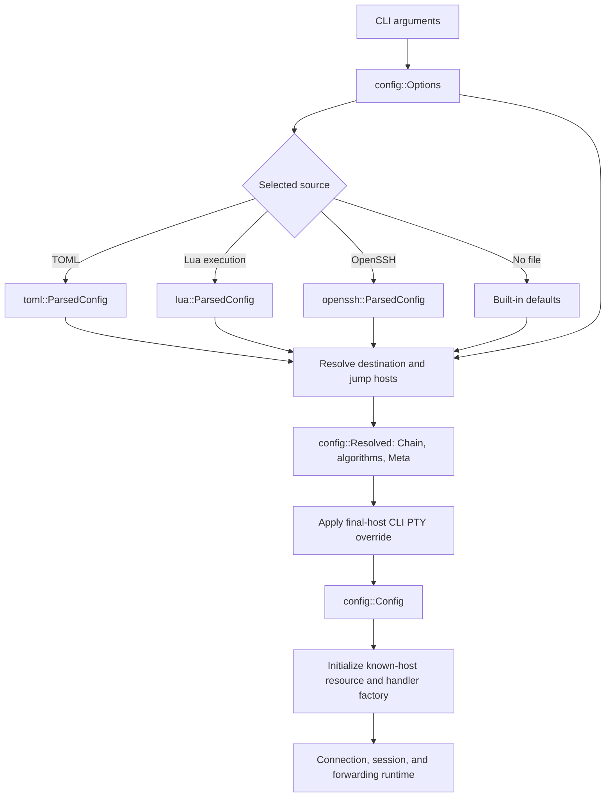

# Configuration architecture

Configuration separates CLI inputs, format-specific parser results, resolved
connection/setup settings, and the final application configuration. These are
concrete types with different responsibilities. The runtime consumes the final
configuration and initialized resources.

The [configuration reference](configuration.md) defines observable loading and
resolution rules. This document describes the types and processing boundaries
that implement them.

## Types and responsibilities

| Type | Meaning | Representation |
| --- | --- | --- |
| `config::Options` | CLI-derived inputs, overrides, and file-selection policy before loading. | Destination alias, optional user/port and overrides, selected file, session and forwarding options. |
| `config::toml::ParsedConfig<'src>` | The result of parsing a TOML document. | Native profiles that can borrow from the source text. |
| `config::lua::ParsedConfig` | The result of executing and deserializing a Lua chunk. | Owned native profiles, independent of the Lua VM and source text. |
| `config::openssh::ParsedConfig` | The result of parsing OpenSSH syntax with the CLI override prefix. | The dependency's `SshConfig`. |
| `config::formats::Profiles<'src>` | Shared Serde representation of native configuration. | Top-level setup metadata, a defaults record, and a map of exact host aliases to `HostFields`. |
| `config::Resolved` | Format-independent result of resolving one source. | A connection `Chain`, per-host algorithm policies, and resolved setup `Meta`. |
| `config::Meta` | Application setup settings for the invocation. | An optional known-host database path. |
| `config::algorithms::Policies` | Algorithm policy associated with each resolved host. | A target policy and optional bastion policies aligned with the `Chain`. |
| `config::Config` | Final application configuration for one invocation. | The resolved chain, algorithms, and metadata plus CLI session, stdin/escape, forwarding, cipher, MAC, and compression settings. |

`Config` is a struct, not a configuration-provider trait or a union of file
formats. It has no Serde implementation, source-text lifetime, Lua value, file
handle, host-pattern table, or format tag. The runtime does not need to know
whether a file was OpenSSH, TOML, Lua, or absent.

The three `ParsedConfig` types are separate concrete types. Parsing or executing
one format does not manufacture another format's parser output. In particular,
TOML and Lua do not go through `ssh2_config::HostParams`: that type belongs to
the OpenSSH parser and its merging rules.

`Profiles` is deliberately a native source representation, not the universal
configuration model. It retains omitted fields, string/list alternatives,
unexpanded paths, defaults, and all named hosts. Sharing this representation
keeps TOML and Lua's common host semantics consistent without imposing their
schema on OpenSSH. Its private `HostFields` records describe supplied fields
rather than a fully resolved SSH host.

`formats::jumps` represents a jump setting as `Jumps::One` or `Jumps::Many`.
Each `Jump` is either `Name(Text)` or `Host(Box<HostFields>)`. Boxing the inline
record permits nested `proxy_jump` without copying the host-field schema.
This shared representation supports Lua's named, inline, and mixed jump forms;
the TOML adapter calls `require_named_jumps()` after deserialization to preserve
its string-only jump syntax.

## Loading pipeline



`cli::parse()` produces `Options`; it does not open configuration files or
establish a connection. `Options::load(self)` discovers one source, resolves its
connection/setup settings into `Resolved`, applies the final-host CLI PTY
override, and moves the remaining application settings into `Config`.

File selection is centralized in `Options`. Neither `Config` nor the runtime
contains extension checks or fallback logic. Explicit `-F`, default-file
precedence, and `-F none` use the same resolution endpoint. Failures from a
selected file retain the filename and underlying error; they do not trigger
fallback to another format.

Each format has an explicit construction step and a separate
`resolve(&Options) -> Result<Resolved>` step:

- TOML: `ParsedConfig::parse(&str)` deserializes the text with `toml` and Serde.
- Lua: `ParsedConfig::execute(&str)` evaluates a Lua 5.4 chunk and deserializes its
  returned value with `mlua`'s Serde deserializer.
- OpenSSH: `ParsedConfig::parse(File, &Options)` seeds CLI overrides, then invokes
  the dependency's parser with `ALLOW_UNSUPPORTED_FIELDS`.

For OpenSSH, the override prefix is part of the parsed result. Parse and resolve
with the same override settings; changing those settings requires reparsing.
The prefix preserves the library's existing matching, `Include` scope, and
first-value/identity-list merging behavior. It is confined to the OpenSSH
adapter.

## Resolution and validation boundaries

Native deserialization handles field names, aliases, unknown fields, scalar
types, and string/list shapes. `formats::values` supplies the small Serde
visitors for borrowed/owned text, strings or arrays, boolean strings, PTY modes,
and integer/string ports. `formats::jumps` distinguishes scalar names, inline
host records, and sequences, including an outer empty sequence used to clear
jumps. Neither module implements a TOML or Lua syntax parser.

Native resolution uses the requested alias for an exact host lookup. It merges
the selected host with defaults and CLI overrides, resolves paths and the
authentication-agent socket, and constructs the dependency's `Host`, `Auth`,
and `Chain` values directly. The dependency's configuration types are the
connection API boundary, not intermediates for translating between file
formats. A borrowed `HostRef` selects either a named `Target` or an inline
`HostFields` record. Named targets perform the exact alias lookup; inline
records bypass that lookup and require an effective `host_name` from themselves
or defaults. Both use the same host-resolution and jump-traversal rules; see
the configuration reference for ordering and inheritance details.

The resolver compiles each effective native algorithm list into typed transport
names. Per-host values override defaults; list modifiers use raw transport
defaults rather than inherited policy lists. `Policies` follows the same target
and reversed-bastion layout as the resolved `Chain`. The handler factory borrows
both and identifies each actual `&Host` by reference identity, so two named or
inline hosts with the same network destination can still have different
policies. It neither clones hosts nor uses destination names as policy keys.

`Meta` is invocation setup, outside the host/default schema. Native metadata
paths resolve under the selected format's path mode. OpenSSH resolution and
the no-file path produce default metadata and omit explicit algorithm policies;
the OpenSSH adapter does not extract new directives for these features.

`formats::paths` implements the native path policy. TOML selects `PathMode::Expand`;
Lua selects `PathMode::Literal`. This choice belongs to the source adapter and
does not survive into `Config`. Literal mode also disables implicit agent
environment lookup: an omitted Lua `identity_agent` resolves to no agent unless
the defaults record supplies an explicit value. Environment reads must occur in
Lua itself, including for default values.

Literal relative paths are rejected in every native profile, including nested
inline jump records. TOML expands selected tilde paths and agent environment
references, then checks that the results are absolute. This preserves lazy
environment resolution instead of expanding every unused host's settings eagerly.

OpenSSH resolution calls the dependency's `Target::query` on its `SshConfig`.
It retains the dependency's path, authentication-default, host-matching, and
jump-chain behavior. Native validation is not applied to the OpenSSH parser's
output.

Configuration loading does not open identity files to inspect key material or
connect to an agent. `Connection::connect()` owns those operations and SSH user
authentication. Server host-key verification is handled separately by the
application's handler using the dependency's known-host implementation.

`Config::preferred()` translates the application's optional cipher, MAC, and
compression preferences into the dependency's `Preferred`. Unknown CLI cipher
or MAC names fail before connection establishment. These are application
settings, independent of the file format used for host settings.

`config::algorithms` validates native names and compiles replacement, append,
remove, and prepend operations. It stores KEX methods separately from protocol
extension signals. Applying a policy preserves the default signals while
replacing methods. Host-key policies distinguish certificates from plain keys
and reject an order the transport cannot represent. An explicit host-key
policy replaces both transport lists and bypasses known-host preference
adjustments; omitted policy retains those adjustments.

Connection setup uses `Meta` to load a `known_hosts::KnownHostsFile` before
constructing the handler factory. This resource owns parsed trust data and the
selected save path. Handlers receive the matching helper and save path rather
than application metadata or configuration-file details. Accepted keys are
persisted through the same selected path.

## Ownership and resource lifetime

TOML profiles use borrowed text where the deserializer provides it. Escaped
strings can be owned when decoding requires allocation. The source `String`
stays alive through resolution and is dropped before connection establishment.
Resolved destination names and authentication paths are owned by the library
connection configuration, so they do not retain the file's text buffer.

Lua deserialization produces `Profiles<'static>` with owned strings. The Lua VM
is dropped before `execute` returns. Resolving a Lua `ParsedConfig` neither
reruns the chunk nor keeps Lua resources alive. The loader is synchronous and
uses no Lua async runtime or shared Lua state.

File descriptors are scoped to reading/parsing. The OpenSSH adapter drops its
buffered reader after parsing; native source files are closed after reading the
text. No configuration file is held open for the network session.

Absent optional lists remain `None`; supplied empty lists remain distinguishable
where merge semantics require it. A single native string does not require a
temporary one-element vector. Resolution borrows profile data, allocates the
owned connection values it needs, and creates a bastion collection only when
jump hosts are present. CLI-owned session and forwarding values move into the
resolved `Config`.

## Module layout and regression boundaries

```text
src/
    known_hosts.rs     Known-host setup resource and selected database path
    config/
        mod.rs         Options, Resolved, Config, Meta, and file loading
        algorithms.rs  Typed per-host policies and algorithm-list operations
        toml.rs        TOML ParsedConfig
        lua.rs         Lua ParsedConfig
        openssh.rs     OpenSSH ParsedConfig and CLI override adapter
        formats/
            mod.rs     Native profiles, metadata, and host/jump resolution
            jumps.rs   Named/inline jump representations and Serde visitors
            values.rs  Native Serde value representations and visitors
            paths.rs   Expansion, literal paths, and agent selection
```

Changes to one parser should stay within its adapter unless the shared native
schema or application semantics change. Changes to native host semantics belong
in `formats`; they must not silently change OpenSSH behavior. New application
settings belong in `Options`/`Config`, with format fields added only when the
configuration specification calls for them.

Inline tests cover cross-format equivalence, parsing once and resolving multiple
hosts, source/VM lifetimes, defaults, overrides, value validation, and path
policies. The separate OpenSSH-backed integration suites verify selection and
resolution through the built CLI. See [Development](development.md) for commands
and fixture ownership.
