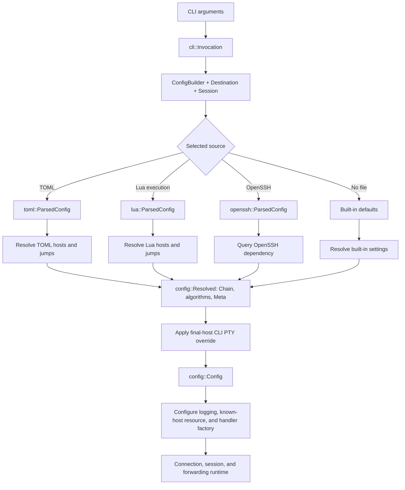

# Configuration architecture

Configuration separates CLI inputs, format-specific parser results, resolved
connection/setup settings, and the final application configuration. These are
concrete types with different responsibilities. The runtime consumes the final
configuration and initialized resources.

The [configuration reference](configuration.md) defines observable loading and
resolution rules. This document describes the types and processing boundaries
that implement them.

The `openrussh-cli-config` workspace package owns configuration, with the Rust
crate name `openrussh_cli_config`. The `config::` prefix below abbreviates that
crate, including its private implementation types. The root `openrussh-cli`
package owns argument parsing and runtime coordination; it consumes the
configuration crate through its public API. The separate `openrussh-cli-terminal`
package owns Unix terminal modes, signals, size queries, suspension, and
asynchronous input resources. Its Rust crate name is `openrussh_cli_terminal`.

## Types and responsibilities

| Type | Meaning | Representation |
| --- | --- | --- |
| `cli::Invocation` | Parsed application arguments before loading. | Destination, session, and optional overrides retained without configuration-file IO. |
| `config::ConfigBuilder` | Public configuration construction API. | Private fields set through consuming fluent methods; destination and session are supplied to `build`. |
| `config::ResolveOptions<'a>` | Private borrowed inputs used during source resolution. | A destination reference and optional identity/jump slices borrowed for resolution; not part of the crate API. |
| `config::ResolveConfig` | Private statically dispatched source-resolution protocol. | Each format's `ParsedConfig` implements `resolve()` independently and returns `Resolved`. |
| `config::toml::ParsedConfig<'src>` | The result of parsing a TOML document. | Native profiles that can borrow from the source text. |
| `config::lua::ParsedConfig` | The result of executing and deserializing a Lua chunk. | Owned native profiles, independent of the Lua VM and source text. |
| `config::openssh::ParsedConfig` | The result of parsing OpenSSH syntax with the CLI override prefix. | The dependency's `SshConfig`. |
| `config::toml::profiles::Profiles<'src>` | TOML source representation. | Borrowed or decoded TOML strings, setup metadata, defaults, and exact named hosts. |
| `config::lua::profiles::Profiles` | Lua source representation. | Owned strings, setup metadata, defaults, named hosts, and named or inline jumps. |
| `config::Resolved` | Format-independent result of resolving one source. | A connection `Chain`, per-host algorithm policies, and resolved setup `Meta`. |
| `config::Meta` | Application setup settings for the invocation. | An optional known-host database path and `LogFilter` policy. |
| `config::LogFilter` | Explicit logging policy, distinct from omission and a single severity level. | `Disabled` or parsed target/span filtering directives. |
| `config::LocalForward` | One supported local forwarding operation. | A TCP variant with TCP endpoints, or a Unix variant with local and remote socket paths. |
| `config::ConnectionConfig` | A resolved connection route and the policy for each host in that route. | Private chain and policies; read-only `chain()` and `algorithm_policy(host)` access. |
| `config::algorithms::Policies` | Private algorithm policy associated with each resolved host. | A target policy and optional bastion policies aligned with the `Chain`. |
| `config::Config` | Final application configuration for one invocation. | A `ConnectionConfig` and metadata plus CLI verbosity, session, stdin/escape, forwarding, cipher, MAC, and compression settings. |
| `config::Error` | Configuration failure with its underlying cause. | Typed error and source chain, with an optional parsed log filter accessible through `log_filter()`. |

`Config` is a struct, not a configuration-provider trait or a union of file
formats. It has no Serde implementation, source-text lifetime, Lua value, file
handle, host-pattern table, or format tag. The runtime does not need to know
whether a file was OpenSSH, TOML, Lua, or absent.

The three `ParsedConfig` types are separate concrete types. Parsing or executing
one format does not manufacture another format's parser output. In particular,
TOML and Lua do not go through `ssh2_config::HostParams`: that type belongs to
the OpenSSH parser and its merging rules.

TOML and Lua own independent profile, host, metadata, value, jump, path, and
resolution implementations. Each source representation retains supplied and
omitted fields, string/list alternatives, defaults, and named hosts until its
own resolver constructs the final connection values. Neither representation is
a shared native base model or an intermediate for another format.

TOML profiles can borrow source text; escaped strings are owned when decoding
requires allocation. Its jump schema accepts names, with inline records
rejected after deserialization so successfully parsed log metadata can remain
available on that error. Lua profiles own `String` values and support named,
inline, and mixed jumps. Lua's inline jump variant boxes its own host record to
permit recursive jump settings.

The formats currently produce equivalent results for documented overlapping
features. That is a property of their present implementations and regression
fixtures, rather than a requirement to keep their schemas or semantics in
lockstep. A change to one format is evaluated against that format's contract.

## Loading pipeline



`cli::parse()` produces an application-owned `Invocation`; it does not open
configuration files or establish a connection. `Invocation::build()` adapts
these parsed values to `ConfigBuilder` and calls its finalizer. Other users of
the configuration crate can construct the builder directly.

`ConfigBuilder::new()` and `Config::builder()` create equivalent builders. Their
defaults leave file discovery and host settings to the resolver, select
nonverbose logging, enable stdin, use `~` as the escape prefix, configure no
local forwards or cipher/MAC override, and leave compression preference off.
Each setter consumes the builder and returns it. The eleven optional settings
are `config_file`, `identities`, `proxy_jump`, `tty`, `verbose`, `stdin_null`,
`escape_char`, `local_forwards`, `compression`, `ciphers`, and `macs`. An empty
jump vector explicitly clears configured jumps, while `escape_char(None)`
disables escapes.

`build(self, destination: Destination, session: Session) -> Result<Config>`
requires both the destination and session at finalization, so a builder cannot
silently manufacture either. It discovers one source, resolves its connection
and setup settings into `Resolved`, applies the final-host CLI PTY override,
seals the chain and policies into `ConnectionConfig`, and moves the remaining
application settings into `Config`.

File selection is centralized in `ConfigBuilder`. Its finalizer creates a
private `ResolveOptions` borrowing the destination and any supplied identity
and jump lists. Source adapters receive that view without owning the builder
or session settings. Neither `Config` nor the runtime contains extension checks
or fallback logic. Explicit `-F`, default-file
precedence, and `-F none` use the same resolution endpoint. Failures from a
selected file retain the filename and underlying error; they do not trigger
fallback to another format. The crate returns its own `Error` and `Result`
types, with no dependency on `anyhow`. `Error` is a public, non-exhaustive enum
covering IO, format parsing/execution, path and algorithm validation, and policy
lookup failures; `Result<T>` aliases `std::result::Result<T, Error>`. `Error::log_filter()` retains a successfully
parsed native filter on later validation or resolution failures, including
TOML jump-shape validation. Reading, execution, or deserialization failures
use the default error filter. The application converts the error at its own
`anyhow` boundary and uses the preserved source chain for diagnostics.
`Error::take_log_filter()` transfers the owned logging policy to subscriber
setup without cloning the filter or consuming the diagnostic.

Each format has an explicit construction step and independently implements the
private `ResolveConfig` trait's
`resolve(&self, &ResolveOptions<'_>) -> Result<Resolved>` operation. A generic
builder helper adds selected-file error context using static dispatch; there
are no trait objects or common native parsing/resolution implementation.

Construction remains format-specific:

- TOML: `ParsedConfig::parse(&str)` deserializes the text with `toml` and Serde.
- Lua: `ParsedConfig::execute(&str, &Path)` receives the source text and selected
  file path, evaluates a Lua 5.4 chunk, and deserializes its returned value with
  `mlua`'s Serde deserializer.
- OpenSSH: `ParsedConfig::parse(File, &ResolveOptions<'_>)` seeds CLI overrides, then invokes
  the dependency's parser with `ALLOW_UNSUPPORTED_FIELDS`.

For OpenSSH, the override prefix is part of the parsed result. Parse and resolve
with the same override settings; changing those settings requires reparsing.
The prefix preserves the library's existing matching, `Include` scope, and
first-value/identity-list merging behavior. It is confined to the OpenSSH
adapter.

The Lua adapter canonicalizes the selected file path before execution. The
absolute path supplies the chunk's debug name and the built-in `cli` module's
`__file__`; its parent supplies `__dir__`. Relative components and symbolic
links therefore resolve consistently in metadata and Lua errors. A
canonicalization failure retains the selected filename in the load error.

The module root `__root__` is the parent of `__dir__` when the canonical filename
is exactly `init.lua`, and `__dir__` otherwise. The filesystem root remains `/`
when there is no higher parent. Before executing the chunk, the adapter prepends
`__root__`'s `?.lua` and `?/init.lua` patterns to `package.path`, preserving the
existing path as a fallback. Lua's normal file searcher can therefore load user
modules under that root, independently of the process working directory.

The adapter registers a `package.preload["cli"]` provider for Lua's normal
`require` and `package.loaded` behavior. Its `user_name`, `home_dir`, and `host_name`
functions call `whoami::username`, `std::env::home_dir`, and `gethostname(2)`
through `nix`, respectively. The `__file__`, `__dir__`, and `__root__` metadata and
the `os`, `arch`, and `os_family` platform values are read-only string constants. The
platform values come from `std::env::consts::{OS, ARCH, FAMILY}` and describe the
binary's compilation target. Registration and requiring the module do not
perform those OS lookups. Each function call obtains a fresh value and returns
Lua `nil` on lookup failure. Lua strings preserve native Unix bytes for paths
and the hostname; deserializing them into native configuration strings retains the
existing UTF-8 requirements. The module does not read `SSH_AUTH_SOCK` or supply
implicit authentication-agent settings.

The module's `debug(v, indent)` helper uses `mlua`'s pretty debug formatting for
arbitrary values, including nested tables and cyclic references, and adjusts
the indentation width (default 2 spaces). It returns a Lua string without printing
or appending a newline; callers choose how to display or use the result.

## Resolution and validation boundaries

Each native format deserializes field names, aliases, unknown fields, scalar
types, and string/list shapes through its own schema. `toml::values` handles
borrowed/owned TOML text and its scalar visitors; `lua::values` handles owned
Lua strings and its scalar visitors. Each format also owns its jump
representation and deserializer. Lua distinguishes names, inline records, and
sequences, including an outer empty sequence that clears jumps; TOML accepts
names only. These visitors consume Serde input rather than parsing the source
language syntax themselves.

Each native resolver currently uses the requested alias for an exact host
lookup, merges the selected host with defaults and CLI overrides, resolves its
own paths and agent setting, and constructs the dependency's `Host`, `Auth`,
and `Chain` values directly. The dependency's configuration types are the
connection API boundary, not intermediates for translating between formats.
Lua's resolver separately handles named targets and inline records: an inline
record bypasses alias lookup and needs an effective `host_name` of its own or
from defaults. TOML resolves named targets and contains no Lua inline-host
model. See the configuration reference for each format's current ordering and
inheritance behavior. The root `defaults` module constructs an owned `Chain`,
`Auth`, and `Meta` for the no-file path independently of either native profile
type. Each native resolver checks the traversed first-jump ancestry for cycles
before constructing connection hosts. Two borrowed cursors detect a repeated
jump source without a heap-allocated visited collection. Named-source identity
uses the lookup alias; Lua inline-source identity uses the record reference.
Embedded users, ports, and resolved network names do not identify jump sources.

The resolver compiles each effective native algorithm list into typed transport
names. Per-host values override defaults; list modifiers use raw transport
defaults rather than inherited policy lists. `Policies` follows the same target
and reversed-bastion layout as the resolved `Chain`. `ConnectionConfig` owns
both behind private fields: callers can neither reorder the chain nor replace
its policy collection independently. The handler factory borrows this one
connection configuration, required by its constructor, and asks
`algorithm_policy(host)` for each actual `&Host` by reference identity. A host from another configuration is rejected,
even when its connection values are identical. Two named or inline hosts with
the same network destination can therefore have different policies. Lookup
neither clones hosts nor uses destination names as policy keys.

`Meta` is invocation setup, outside each format's host/default schema. Metadata
paths resolve under that format's own rules. The final `Meta::log_filter` holds
`Option<LogFilter>`: omission selects the CLI default, `Disabled` explicitly
suppresses diagnostics, and `Filter` contains parsed directives rather than a
single severity level. Source keys remain `log-level` and `log_level`.
Optional log directives use
`LogFilter::try_from_filter()` or its standard `FromStr` implementation, backed
by `tracing_subscriber::EnvFilter`. Native Serde deserialization parses string
visitors directly without an intermediate owned string. The directives combine
with the CLI verbosity flag when configuring the tracing subscriber. An omitted
filter means error-only logging without `-v` and debug logging with `-v`; an explicit empty
string means error-only logging in either mode. Non-verbose mode additionally
caps any filter at errors. OpenSSH resolution and the no-file path produce
default metadata and omit explicit algorithm policies; the OpenSSH adapter does
not extract new directives for these features.

`toml::paths` implements TOML's tilde expansion, agent environment selectors,
and absolute-path validation. `lua::paths` independently validates literal
absolute paths and never performs implicit agent environment lookup. An omitted
Lua `identity_agent` resolves to no agent unless defaults supply an explicit
value. Environment reads must occur in Lua itself, including for defaults.
There is no shared path-mode switch or native path resolver, and these
source-specific policies do not survive into `Config`. CLI identity overrides
retain library-compatible expansion behavior implemented separately by TOML,
Lua, and the no-file resolver. This duplication keeps their source-resolution
paths independent.

Literal relative paths are rejected in every native profile, including nested
inline jump records. TOML expands selected tilde paths and agent environment
references, then checks that the results are absolute. This preserves lazy
environment resolution instead of expanding every unused host's settings eagerly.

OpenSSH resolution calls the dependency's `Target::query` on its `SshConfig`.
It retains the dependency's path, authentication-default, host-matching, and
jump-chain behavior. Native validation is not applied to the OpenSSH parser's
output. Its jump-cycle limitation also remains: adding a separate traversal
through the current dependency's allocating host matcher would increase normal
resolution allocations. Correcting that path requires a dependency-level change
or an allocation-free matching API.

Configuration loading does not open identity files to inspect key material or
connect to an agent. `Connection::connect()` owns those operations and SSH user
authentication. Server host-key verification is handled separately by the
application's handler using the dependency's known-host implementation.

`Config::preferred()` translates the application's optional cipher, MAC, and
compression preferences into the dependency's `Preferred`. Unknown CLI cipher
or MAC names fail before connection establishment. These are application
settings, independent of the file format used for host settings.

`config::algorithms` validates transport algorithm names and compiles
replacement, append, remove, and prepend operations. Its private `AlgorithmList`
trait lets each format's string-list type supply its own iteration; default
trait methods invoke the transport compiler. It shares transport-policy
operations without sharing source-language parsing, scalar/list types, or host
resolution. It stores KEX methods separately from protocol
extension signals. Applying a policy preserves the default signals while
replacing methods. Host-key policies distinguish certificates from plain keys
and reject an order the transport cannot represent. An explicit host-key
policy replaces both transport lists and bypasses known-host preference
adjustments; omitted policy retains those adjustments.

Connection setup uses `Meta` to load a `known_hosts::KnownHostsFile` before
constructing the handler factory. This resource owns parsed trust data and the
selected save path. Handlers receive the matching helper and save path rather
than application metadata or configuration-file details. Accepted keys are
persisted through the same selected path.

## Ownership and resource lifetime

TOML profiles use borrowed text where the deserializer provides it. Escaped
strings can be owned when decoding requires allocation. The source `String`
stays alive through resolution and is dropped before connection establishment.
Resolved destination names and authentication paths are owned by the library
connection configuration, so they do not retain the file's text buffer.

Lua deserialization produces its own `Profiles` with owned strings and no
source-text lifetime. The Lua VM is dropped before `execute()` returns. Resolving a Lua `ParsedConfig` neither
reruns the chunk nor keeps Lua resources alive. The loader is synchronous and
uses no Lua async runtime or shared Lua state.

File descriptors are scoped to reading/parsing. The OpenSSH adapter drops its
buffered reader after parsing; native source files are closed after reading the
text. No configuration file is held open for the network session.

Absent optional lists remain `None`; supplied empty lists remain distinguishable
where merge semantics require it. A single native string does not require a
temporary one-element vector. Resolution borrows profile data, allocates the
owned connection values it needs, and creates a bastion collection only when
jump hosts are present. CLI-owned session and forwarding values move into the
resolved `Config`.

`LocalForward` is a sum of supported operations, not a product of independent
local and remote transport choices. Its TCP variant carries both TCP endpoints;
its Unix variant carries a native local `PathBuf` and a remote `String` path.
Mixed transports cannot be constructed. The runtime preserves this pairing in
its listener and accepted-stream variants, with owned target names only at
existing task boundaries.

## Module layout and regression boundaries

```text
src/
    cli.rs                 Argument parsing and the builder adapter
    logging.rs             Tracing initialization and stderr formatting
    known_hosts.rs         Known-host setup resource and selected database path
    handler.rs             Runtime policy application and host-key checks
crates/openrussh-cli-config/
    Cargo.toml             Configuration-only dependencies
    src/
        lib.rs             Config, ConnectionConfig, Meta, model types, and private resolution inputs
        builder.rs         ConfigBuilder, file discovery, and static source dispatch
        defaults.rs        Independent no-file connection/authentication defaults
        error.rs           Typed configuration errors and source context
        tests.rs           Cross-format loading, builder, and resolution tests
        algorithms.rs      Typed policies, AlgorithmList, and transport-list operations
        openssh.rs         OpenSSH ParsedConfig and CLI override adapter
        toml/
            mod.rs         TOML ParsedConfig
            profiles.rs    TOML profiles, metadata, and named-host resolution
            jumps.rs       TOML named jumps and shape validation
            values.rs      Borrowed TOML text and scalar/list visitors
            paths.rs       TOML expansion, agent selectors, and path validation
            resolution_tests.rs  TOML resolution tests
        lua/
            mod.rs         Lua ParsedConfig and source-path handling
            profiles.rs    Owned Lua profiles, metadata, and host/jump resolution
            jumps.rs       Lua named/inline jumps and sequence visitors
            values.rs      Owned Lua strings and scalar/list visitors
            paths.rs       Literal Lua paths and explicit agent settings
            cli.rs         Built-in Lua cli module
            tests.rs       Lua execution and resolution tests
    tests/builder.rs       External public-builder API tests
crates/openrussh-cli-terminal/
    Cargo.toml             Terminal-only dependencies and member feature selection
    src/lib.rs             Unix signal, terminal, size, suspension, and input APIs
```

Format-specific schema and resolution changes belong in that format's module.
A TOML change does not imply a Lua change, and vice versa; neither should
silently change OpenSSH behavior. Common final configuration and transport
policies remain separate from all source representations. The private
`ResolveConfig` trait shares only the source-resolution operation and output
contract; `AlgorithmList` shares only transport-list operations. New application
settings cross the public `ConfigBuilder`/`Config` boundary, with format fields
added only when the configuration specification calls for them.

Format-local tests cover parsing once and resolving multiple hosts, source/VM
lifetimes, defaults, overrides, value validation, and path rules. Selected
cross-format fixtures record equivalent current outcomes for overlapping
features without imposing shared future semantics. External builder tests
exercise the public crate API. README-example and handler-boundary regressions
remain in the application, while the separate OpenSSH-backed integration suites
verify selection and resolution through the built CLI. See
[Development](development.md) for commands and fixture ownership.
